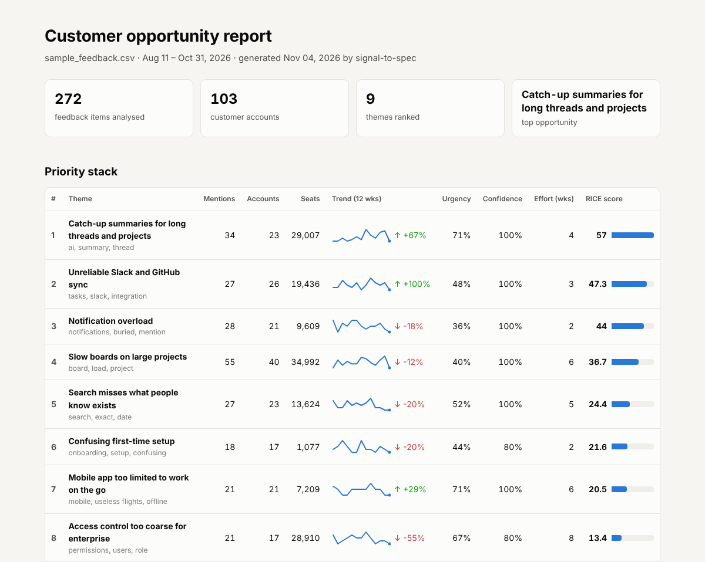
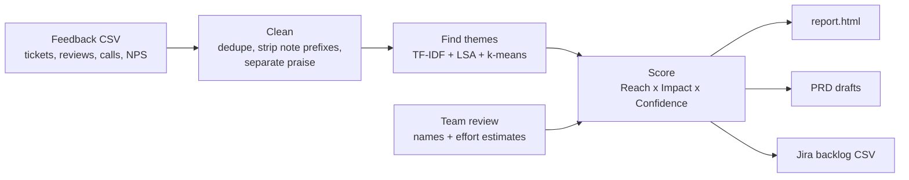

# signal-to-spec

**Turn a pile of raw customer feedback into a ranked list of product opportunities, a PRD draft and a Jira-ready backlog.**

Product teams hear from customers everywhere: support tickets, app reviews, sales calls, NPS comments, forums, interviews. The hard part isn't collecting it, it's deciding what it adds up to and what engineering should build next. `signal-to-spec` is a small prototype of that workflow: it groups feedback into themes, scores each theme on reach, impact and confidence, folds in engineering effort, and writes the artifacts a PM would hand to a team.



## What it does



| Output | What it's for |
|---|---|
| `report.html` | One-page opportunity report: ranked themes, trend sparklines, segment mix, customer quotes, method |
| `prd_*.md` | A PRD draft per top opportunity: evidence table, quotes, affected accounts, success metrics, risks, open questions |
| `jira_backlog.csv` | Epics with discovery, spike and instrumentation tasks, importable with Jira's CSV importer |
| `opportunities.csv` | Every theme with its scores, for your own analysis |

Sample outputs from the included dataset are in [`examples/`](examples/).

## Quick start

```bash
git clone https://github.com/Somyak173/signal-to-spec.git
cd signal-to-spec
python -m venv .venv && source .venv/bin/activate   # Windows: .venv\Scripts\activate
pip install -r requirements.txt

# 1. Customer view only
python -m signal_to_spec data/sample_feedback.csv -o output

# 2. Add the team's review: theme names and engineering estimates
python -m signal_to_spec data/sample_feedback.csv -o output --review data/team_review.csv

open output/report.html     # Windows: start output\report.html
```

Run the tests with `pytest`.

## The interesting part: customers vs. engineering

The two runs above rank the same themes differently, and that difference is the point.

| Theme | Customer view only (opportunity score) | With engineering effort (RICE) |
|---|---|---|
| Catch-up summaries for long threads and projects | #1 (228) | **#1** (57, 4 wks) |
| Slow boards on large projects | #2 (220) | #4 (36.7, 6 wks) |
| Unreliable Slack and GitHub sync | #3 (142) | **#2** (47.3, 3 wks) |
| Notification overload | #7 (88) | **#3** (44, 2 wks) |
| Access control too coarse for enterprise | #6 (107) | #8 (13.4, 8 wks) |

Slow boards touch the most accounts, but notification overload is a two-week fix that 21 accounts are asking for. Summaries are both the fastest-growing request (+67% in the last four weeks, mostly from Premium and Enterprise accounts) and relatively cheap. A PM still has to make the call (enterprise access control may matter more than its score says if a renewal depends on it), but the tool makes the trade-off visible instead of leaving it to whoever is loudest.

## How the scoring works

It's a RICE-style model computed from the feedback itself:

| Factor | How it's measured |
|---|---|
| **Reach** | Unique accounts raising the theme, weighted by plan (Free 1, Standard 2, Premium 3, Enterprise 5) |
| **Impact** | RICE scale 0.25 to 3, from pain (VADER sentiment) and urgency language: blocked work, churn risk, willingness to pay |
| **Confidence** | 50 / 80 / 100%, from how many channels and plans corroborate the theme, and its volume |
| **Effort** | Person-weeks from the team review file (optional) |

`Opportunity score = Reach × Impact × Confidence`, and `RICE = Opportunity score ÷ Effort` once estimates exist. Scores compare themes within one dataset; they're a starting point for discovery, not a verdict.

### Finding themes

1. **Clean.** Strip note-taker prefixes ("Customer said: ..."), and count the same customer posting the same thing twice only once. Different customers raising the same issue are kept: repeated asks are signal.
2. **Separate "how much" from "what".** Sentences like "Please prioritize this" or "Our renewal is coming up" feed the urgency score but are removed from theme detection, so they don't pull unrelated feedback together.
3. **Route praise.** Clearly positive feedback with no complaint or request goes to a "What's working" section instead of the problem ranking.
4. **Cluster.** TF-IDF on stemmed words and phrases, compressed with LSA to a handful of latent topics, then k-means (k picked by silhouette score). Clusters that are two halves of one theme are merged back together, and any low-coherence catch-all group is flagged for a human read rather than ranked.

On the synthetic data (where the true themes are known) about 87% of items land in the right theme.

## Input format

A CSV with one row per piece of feedback:

| Column | Example |
|---|---|
| `id` | FB-0001 |
| `date` | 2026-08-14 |
| `source` | Support ticket, App review, Sales call, NPS comment, Community forum, Customer interview |
| `segment` | Free, Standard, Premium, Enterprise |
| `account` | Bluefin Labs |
| `seats` | 240 |
| `text` | The board view is painfully slow once a project gets big. |

The optional team review file maps a keyword to a theme name and an estimate:

```csv
match,name,effort_weeks
notification,Notification overload,2
```

## Importing the backlog into Jira

In Jira, use the CSV importer and map `Issue Id` → Issue ID, `Parent Id` → Parent ID, and both `Labels` columns → Labels. Each epic arrives with three tasks: interview five affected accounts (named in the task), an engineering spike, and an instrumentation task to baseline a success metric.

## Project structure

```
signal_to_spec/
  ingest.py      load, validate, clean, dedupe
  themes.py      theme discovery and labelling
  scoring.py     sentiment, urgency, Reach/Impact/Confidence, team review
  artifacts.py   PRD drafts, Jira CSV, opportunities CSV
  report.py      self-contained HTML report
  llm.py         optional drafting step (off by default)
  cli.py         command line
data/
  generate_sample_feedback.py   seeded generator for the synthetic dataset
  sample_feedback.csv           280 feedback items for "Relay", a fictional work-tracking tool
  team_review.csv               example names and engineering estimates
examples/                       outputs from the sample data
tests/
```

## Limitations and next steps

- **The sample data is synthetic.** Relay, its customers and every quote are invented so the project can be shared publicly. Real feedback is messier.
- **Bag-of-words themes.** TF-IDF can't tell that "slow" and "takes forever" mean the same thing. Sentence embeddings would cluster better; I kept the core dependency-light so it runs anywhere in seconds.
- **Sentiment is a proxy for pain.** VADER is tuned for social media, and plenty of serious complaints are written politely. Urgency language and revenue weighting partly compensate.
- **Next:** pull feedback straight from support tools via their APIs, add a competitor-feature matrix per theme, and compare the ranking against usage data before trusting it.

---

Built by [Somyak Agarwal](https://www.linkedin.com/in/somyak-agarwal-4a4507302) · BU Questrom, BS Business Administration + BS Computer Science · MIT License
